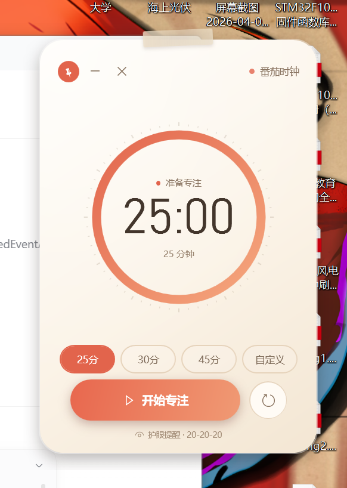
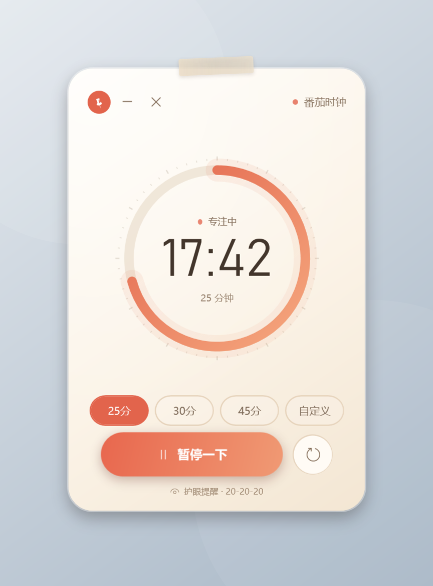
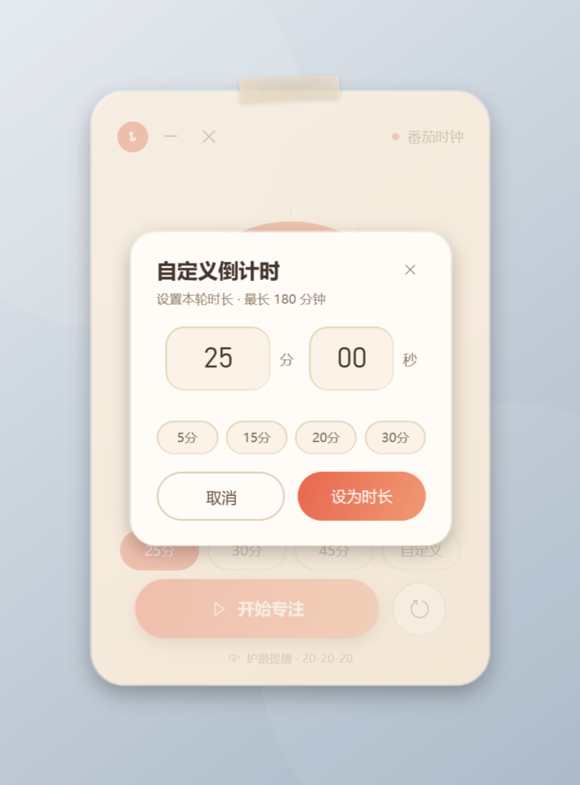
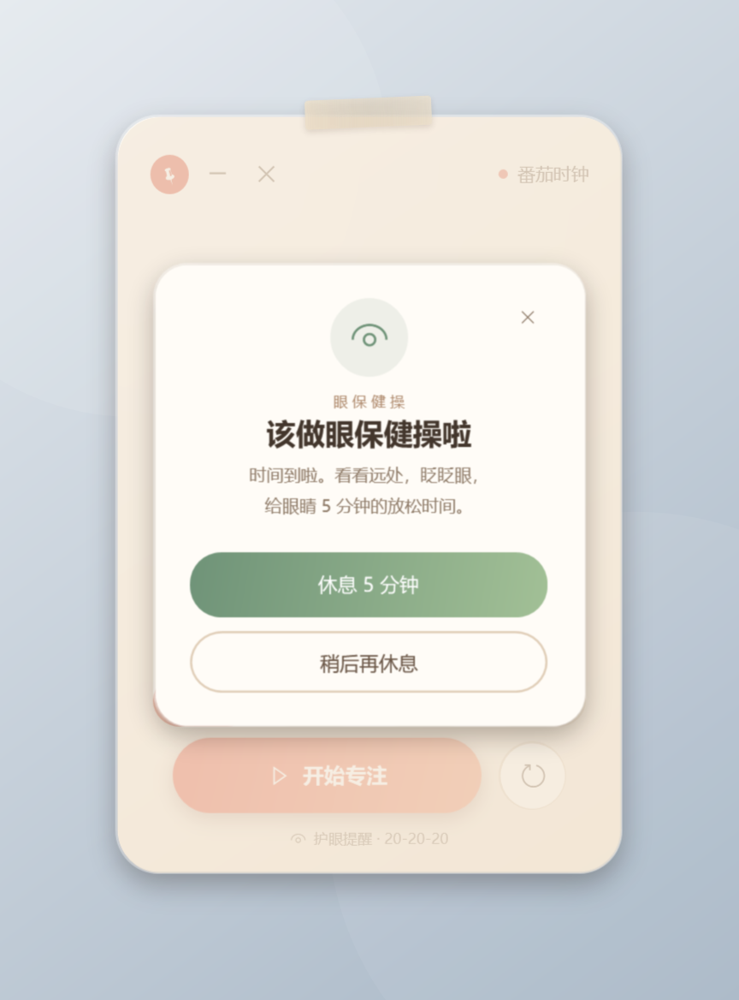

# Tomato Clock · Eye-care Pomodoro Sticky Note

**English** | [简体中文](README.md)


A tiny, always-on-top Pomodoro timer for the Windows desktop. When the countdown ends, it plays a soft chime and reminds you to rest your eyes with a five-minute eye-care break.

<p align="center">
  
</p>

## Why

Most Pomodoro apps are full windows. Tomato Clock is a sticky note: a circular countdown, three tiny window controls, and a clear eye-care reminder. It is built with the WPF / .NET Framework that ships with Windows. The executable is about **390 KB**, with no Electron, no NuGet packages, no network access, and no ads.

## Download

1. Open [Releases](../../releases/latest).
2. Download `tomato-clock-windows.zip` and unzip it.
3. Double-click **`番茄时钟.exe`**.

> No release yet? Download the `tomato-clock-windows` artifact from the latest **Actions → Build** run.

Requires Windows 10/11 with .NET Framework 4.8 (normally included).

## Build from source

```powershell
git clone https://github.com/G-YUAN1524/tomato-clock.git
cd tomato-clock
powershell -NoProfile -ExecutionPolicy Bypass -File .\build.ps1
.\番茄时钟.exe
```

The build uses the in-box `csc.exe` and WPF assemblies. No network dependency, no package restore.

## Features

- Three buttons at the top-left: **pin on desktop** (always-on-top), **minimize**, **exit**.
- Circular countdown ring that shrinks as time passes; remaining `mm:ss` in the center.
- 25 / 30 / 45 minute presets, plus a custom duration from 1 second to 180 minutes.
- Start, pause, resume, and reset. Keyboard shortcuts: `Space`, `R`, `Esc`.
- Completion chime and an eye-exercise card. Start a **5-minute eye-care break** in one click.
- Frameless, rounded sticky-note design with a paper-tape accent; drag anywhere on the card.
- Remembers its position, duration, and pin state in `%APPDATA%\番茄时钟\settings.ini`.
- System tray icon, single-instance guard, no installer.

## Screenshots

<p>
  
  
  
</p>

## Tech

- C# 5 / WPF / .NET Framework 4.8
- Custom `ProgressRing` control with `OnRender`
- `DispatcherTimer` countdown, embedded XAML and WAV resources
- UI Automation test: `tools/ui-test.ps1`
- GitHub Actions build and tag-based release workflow

## Contributing

Issues and pull requests are welcome. See [CONTRIBUTING.md](CONTRIBUTING.md). The UI test needs an interactive Windows desktop, so CI only builds and packages the app.

## License

[MIT](LICENSE) © 2026 G-YUAN1524

If this little note helps you remember to rest your eyes, a ⭐ is appreciated.


