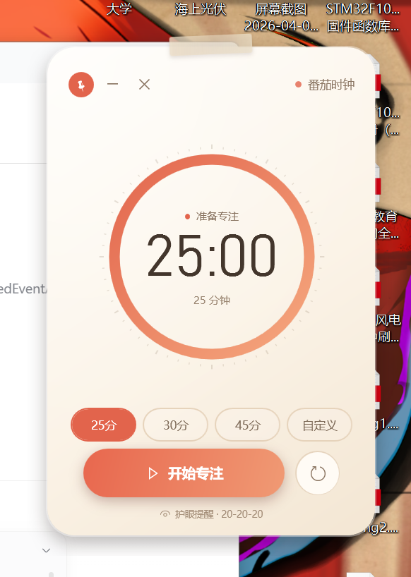
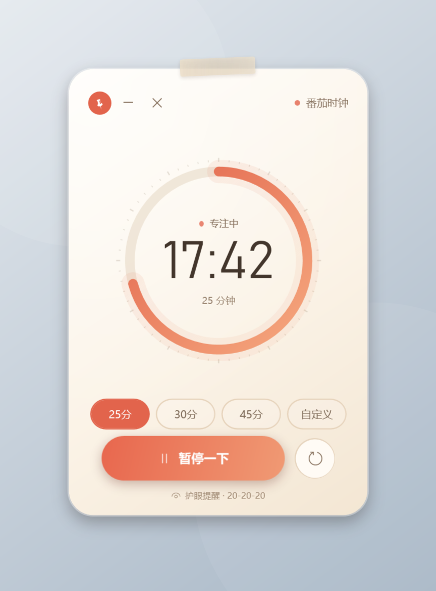
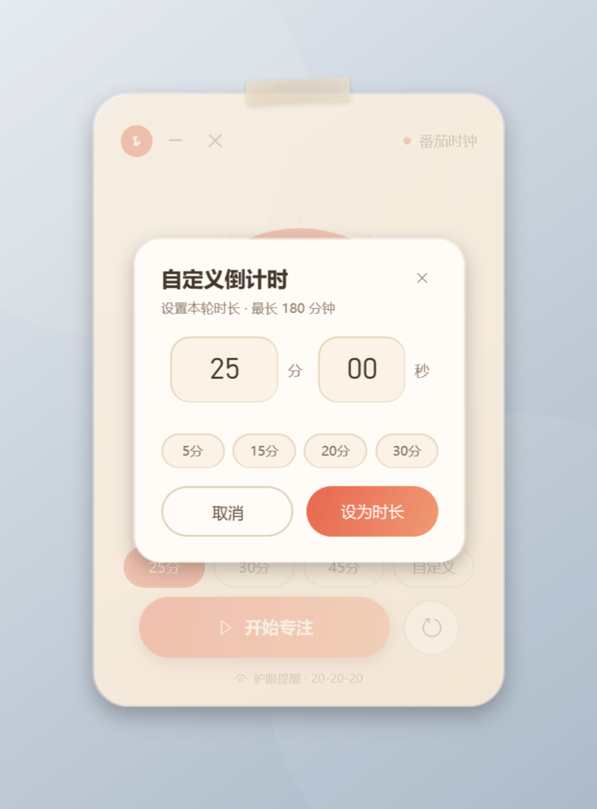
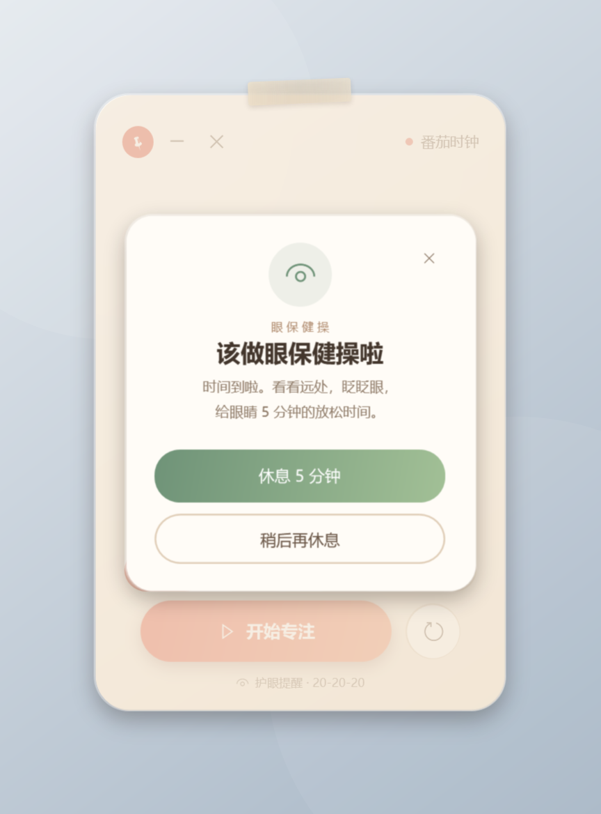
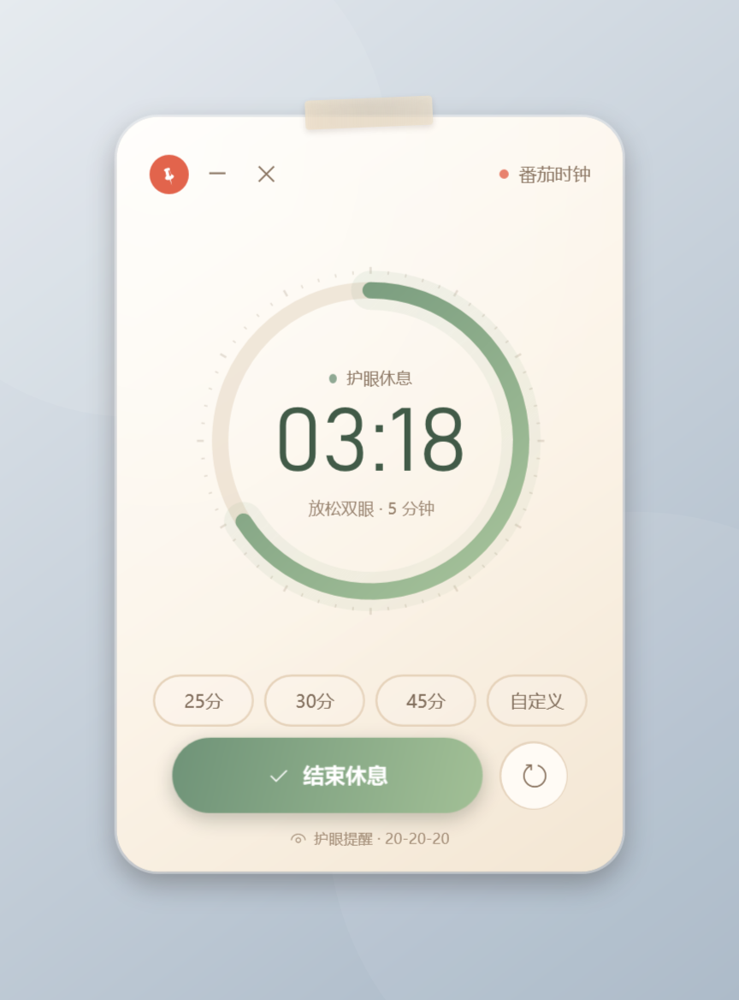
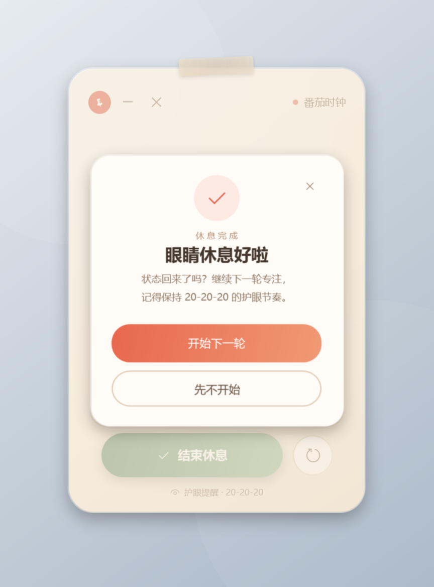

# 番茄时钟 · 护眼便笺

[English](README.en.md) | **简体中文**


一个贴在 Windows 桌面上的小番茄钟。倒计时结束时，它会用轻柔的提示音和一张眼保健操卡片提醒你休息眼睛。

<p align="center">
  
</p>

## 为什么做这个

市面上的番茄钟通常是一个完整窗口，而不是一张可以随手放在屏幕角落的便笺。这个项目只做几件事：**一个圆环、一个倒计时、一眼能看懂的护眼提醒**。

它使用 Windows 自带的 WPF / .NET Framework 构建，exe 只有约 **390 KB**，没有 Electron、没有 NuGet 依赖、不联网、无广告。

## 下载与运行

### 普通用户

1. 打开 [Releases](../../releases/latest)。
2. 下载 `tomato-clock-windows.zip` 并解压。
3. 双击 **`番茄时钟.exe`** 启动。

> 如果还没有 Release，可以在仓库的 **Actions → Build → 最新一次运行 → Artifacts** 下载 `tomato-clock-windows`。

系统要求：Windows 10 / 11，已启用 .NET Framework 4.8（Windows 10/11 通常自带）。

### 从源码构建

```powershell
git clone https://github.com/G-YUAN1524/tomato-clock.git
cd tomato-clock
powershell -NoProfile -ExecutionPolicy Bypass -File .\build.ps1
.\番茄时钟.exe
```

构建使用 Windows 自带的 `csc.exe` 和 WPF 程序集，**不需要联网安装依赖**。编译产物 `番茄时钟.exe` 与 `番茄时钟.exe.config` 不会提交进仓库。

## 功能

- **左上角三个按钮**
  - 图钉：固定在桌面（始终置顶），再点一次取消。
  - 横线：最小化到任务栏，倒计时继续；结束时自动回到桌面提醒。
  - ×：退出应用。
- **圆环倒计时**：彩色圆弧随时间流逝逐渐缩短，中央显示剩余 `分:秒`。
- **时长选择**：25 分、30 分、45 分，或「自定义」——支持 1 秒到 180 分钟，可分别填写分和秒。
- **专注控制**：开始 / 暂停 / 继续；右侧圆箭头重置本轮。
- **眼保健操提醒**：专注结束后播放提示音，弹出「该做眼保健操啦」，可直接开始 **5 分钟护眼休息**；休息结束后可开始下一轮。
- **便笺体验**：无边框圆角、柔和阴影、顶部和纸胶带；按住空白处即可拖动。
- **自动记忆**：位置、上次时长、固定状态保存在 `%APPDATA%\番茄时钟\settings.ini`。
- **托盘图标**：双击显示窗口，右键退出。

### 快捷键

| 按键 | 功能 |
| --- | --- |
| `空格` | 开始 / 暂停 |
| `R` | 重置本轮 |
| `Esc` | 关闭当前弹层 |

## 界面预览

<p>
  
  
  
</p>

护眼休息模式使用绿色圆环；休息完成后可以开始下一轮：

<p>
  
  
</p>

## 技术实现

```text
C# / WPF (.NET Framework 4.8)
├─ 无边框透明窗口 + DropShadowEffect
├─ 自绘 ProgressRing（圆弧、刻度、渐变、圆角线帽）
├─ DispatcherTimer 驱动倒计时，按剩余比例刷新圆环
├─ 内嵌 XAML 与 WAV 资源，单文件 exe
└─ AppSettings 持久化到 %APPDATA%
```

- 编译器：Windows 自带 `C:\Windows\Microsoft.NET\Framework64\v4.0.30319\csc.exe`（C# 5）。
- 界面：`ui/MainWindow.xaml`，通过 `XamlReader` 从嵌入资源加载。
- 圆环：`src/ProgressRing.cs`，继承 `FrameworkElement` 并重写 `OnRender`。
- 计时状态机与窗口行为：`src/MainWindow.cs`。
- 设置：`src/AppSettings.cs`。
- 图标与提示音生成：`tools/make_assets.py`。

## 文件结构

```text
番茄时钟/
├─ 番茄时钟.exe              # 本地构建产物（已被 git 忽略）
├─ 番茄时钟.exe.config       # 构建时生成（已被 git 忽略）
├─ README.md / README.en.md
├─ LICENSE                   # MIT
├─ CHANGELOG.md
├─ CONTRIBUTING.md
├─ build.ps1                 # 一键编译
├─ app.manifest / app.config # DPI 与运行时配置
├─ src/                      # C# 源码
├─ ui/                       # XAML 界面与样式
├─ assets/                   # 图标、提示音
├─ docs/screenshots/         # README 截图
├─ tools/                    # 素材生成、UI 自动化验收
└─ .github/                  # Actions、Issue / PR 模板
```

## 自动化验收

```powershell
powershell -NoProfile -ExecutionPolicy Bypass -File .\tools\ui-test.ps1
```

该脚本会真实启动应用，通过 Windows UI Automation 检查：

- 默认 25:00 与开始/暂停/继续
- 25 / 30 / 45 分钟预设切换
- 固定按钮是否真的改变窗口置顶状态
- 自定义时长校验（0 秒会被拒绝）
- 倒计时结束后的眼保健操提醒
- 5 分钟护眼休息与返回专注
- 最小化、恢复、退出

> UI 测试需要一个交互式 Windows 桌面，因此不在 GitHub Actions 中运行；CI 只做编译与产物打包。

## 兼容性说明

- 支持 Windows 10 / 11；界面在 100% 与 150% DPI 下均已检查。
- 「固定在桌面」指窗口**始终置顶**，不会被其他窗口盖住。
- 项目没有联网代码；如果不希望应用在托盘常驻，退出即可。
- 本地编译的 exe 未签名，Windows 可能提示「未知发布者」；可选择「更多信息 → 仍要运行」。

## 参与贡献

欢迎 Issue、PR 和 Star。提交前请阅读 [CONTRIBUTING.md](CONTRIBUTING.md)。

可参与的方向：高 DPI / 多显示器、主题与动画、眼保健操动作提示、可访问性、中英文界面切换。

## License

[MIT](LICENSE) © 2026 G-YUAN1524

如果这个便笺帮你记得休息眼睛，欢迎点一个 ⭐。


